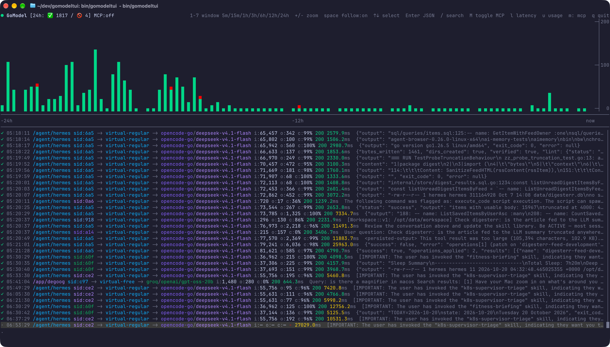
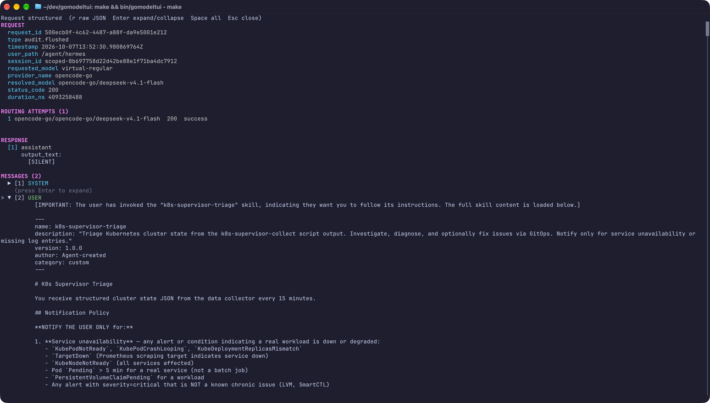
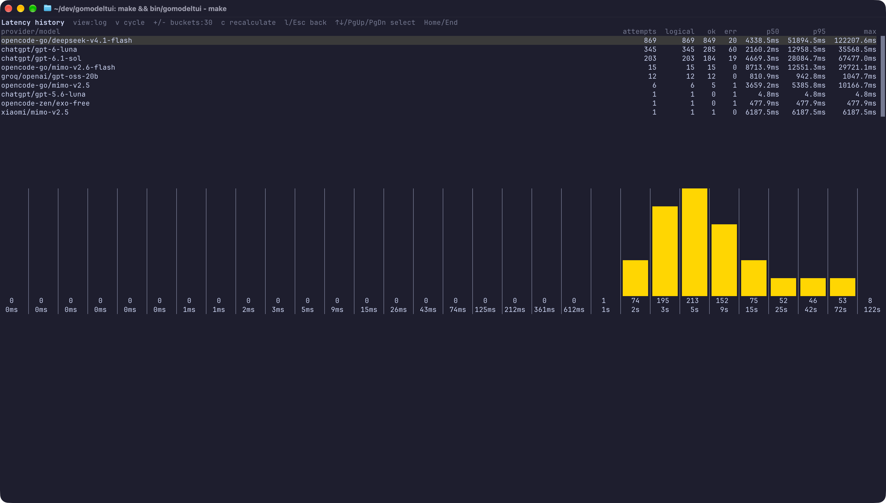

# gomodeltui

> [!WARNING]
> **This application was fully vibe-coded. No human has ever reviewed the
> source code.** It has not been audited for correctness, security, or
> safety. Use it at your own risk — do not treat it as reviewed or trusted
> software, and review the code yourself before relying on it.

[](https://github.com/a-bali/gomodeltui/actions/workflows/ci.yml)
[](https://github.com/a-bali/gomodeltui/releases)
[](go.mod)
[](LICENSE)

A read-only terminal UI for GoModel request activity, live audit logs, latency
statistics, MCP traffic, and provider quotas. `gomodeltui` streams the GoModel
admin audit log, backfills recent history, and renders everything in a single
terminal window — without writing to your GoModel instance or changing any
provider account state.

## Native macOS menu bar app

The repository also includes a [native macOS app](macos/README.md) with a
compact request chart and red error strip in the menu bar. Click any GoModel
menu bar icon to toggle a panel half the display width, with a native stacked
bar chart covering 5m–24h and a dense, scrolling, color-coded request log. The
main activity icon always covers the last hour.
Drag either bottom corner to resize the dropdown; its size is remembered.
Drag the divider to adjust the space given to the chart and logs.
Chart buckets follow fixed clock intervals, with the current partial bucket
updating as requests arrive. Idle charts advance only at bucket boundaries.
The live log keeps one hour and loads earlier requests as you scroll back.
Drag across the chart to filter an interval, or click a bucket; missing history
is backfilled. A bottom **Live** button appears while browsing earlier logs or
other time windows and returns to the current hour.
Use the **MCP** checkbox beside the time-window picker to include MCP activity
in both native charts, request totals, and log entries
(excluded by default). The log scrolls vertically and highlights hovered rows
with a subtle background and pointing-hand cursor, with no row tooltips.
Click a log line for the full request JSON in a collapsible, syntax-highlighted
native inspector with search and previous/next match controls.
Its **Word wrap** checkbox wraps long values at their JSON indentation;
horizontal scrolling is available in the popup when wrapping is off.
Click container rows to toggle them, or use **Expand All / Collapse All**.

Build with `make macos`, then open `bin/GoModel.app` (macOS 14+, Swift 6).
It reads the existing TUI configuration; right-click the main icon for
**Configuration**, provider **Usage icons**, **Reconnect**, and **Quit GoModel**.
Run `open bin/GoModel.app --args --demo` to preview it without a server.

The native chart counts each completed logical model request once, by final
outcome; the TUI chart counts routing attempts. MCP traffic is excluded by
default and can be included in the native charts with the MCP checkbox.
See the [app documentation](macos/README.md) for details.

## Screenshots

These screenshots show the current TUI and native macOS interfaces.

### Live activity and request log



The default screen pairs a stacked green/red bar chart with the live
request log. Use `1`–`7` to switch between 5-minute and 24-hour windows. Each
log row shows the outcome, timestamp, path, session, client and routed model,
input/output tokens, cache ratio, HTTP status, duration, and a preview of the
last conversation turn.
Bars use fixed clock-aligned buckets, so existing activity stays steady between
bucket boundaries. Press `M` to include MCP calls in both the chart and the log;
MCP starts excluded, while `m` opens the separate MCP statistics screen.
Input/output token counts use thousands separators; missing usage uses `—`,
and known zeros remain `0`. Missing previews are fetched lazily for visible
backfilled model requests, with at most two concurrent lookups and bounded text.

### Request details



Press `Enter` on a log row to inspect a request. The structured view shows
request metadata, every routing attempt (including failovers and error codes),
the response body, and the conversation messages. Toggle raw JSON with `r`, and
expand or collapse individual messages with `Enter` or `Space`.
Enter retrieves the complete persisted request even when its audit ID must first
be resolved from the request ID. Press `R` in the inspector to reload or retry
content. Loading preserves the selected view, message expansion, and scroll
position. Full fetched bodies are retained only while the inspector is open.

### Latency history



Press `l` for per provider/model latency statistics — attempts, logical
requests, successes, errors, p50, p95, and max — with a histogram of the
selected model. Cycle between linear, logarithmic, and p99 + overflow
distributions with `v`, and adjust the bucket count with `+`/`-`.

### Native macOS menu bar app


See the [macOS app guide](macos/README.md) for configuration and usage details.

## Features

- **Live audit stream** over Server-Sent Events, with automatic reconnect and
  `Last-Event-ID` resume so no completed request is missed during a blip.
- **History backfill** for the selected chart window on startup, when widening
  the window, and after reconnects. The request log shows entries from that same
  window; older completed content is still fetched lazily as previews or when
  opening a request.
- **Activity chart** with clock-aligned stacked success/error bars, seven zoom
  windows, and an MCP inclusion toggle shared with the log.
- **Request log** with route, session, token, cache, status, and latency
  columns, full-text search, follow mode, and a scrollbar. Pending requests show
  elapsed latency refreshed every 0.1 seconds; the final response duration
  replaces it when the request completes.
- **Request inspector** with structured and raw JSON views, routing-attempt
  details, prompt/response message expansion, and lazy loading of omitted
  bodies from the audit detail endpoint, including audit-ID resolution.
- **Latency analytics** per provider/model with p50/p95/max and switchable
  histogram distributions.
- **MCP statistics** for JSON-RPC methods and tools, kept separate from model
  traffic so MCP calls never skew model metrics.
- **Provider quotas** for OpenCode Go, Command Code, ChatGPT / Codex, OpenRouter,
  DeepSeek, and Xiaomi MiMo. Quota windows use progress bars and reset countdowns;
  API-backed balances and key spending are shown as details.
- **Flexible configuration** via YAML, environment variables, and flags, with a
  documented [sample file](config.example.yaml).
- **Read-only by design**: credentials are read from local files or environment
  variables and are never written, refreshed, or transmitted anywhere except
  the provider endpoint that issued them.

## Requirements

- A reachable GoModel instance with an admin API key that can read
  `/admin/live/logs`, `/admin/audit/log`, and `/admin/audit/detail`.
- A terminal with 256-colour or truecolour support.
- Go 1.26 or newer to build from source (or the provided Nix dev shell).

## Installation

### Prebuilt binaries

Download the archive for your platform from the
[releases page](https://github.com/a-bali/gomodeltui/releases), extract it, and
put `gomodeltui` on your `PATH`. Archives are published for Linux, macOS, and
Windows on `amd64` and `arm64`.

### With the Go toolchain

```sh
go install github.com/a-bali/gomodeltui/cmd/gomodeltui@latest
```

### From source

```sh
git clone https://github.com/a-bali/gomodeltui.git
cd gomodeltui
make build        # produces bin/gomodeltui
```

The repository ships a Nix flake with Go, `gopls`, and `golangci-lint`:

```sh
nix develop
make build
```

## Quick start

Set the required GoModel API key and run the TUI:

```sh
export GOMODEL_URL=http://localhost:8080
export GOMODEL_API_KEY=your-gomodel-api-key
gomodeltui
```

The header always shows the active keybindings, and `q` (or `Ctrl+C`) quits.
To monitor provider quotas, press `u`; for latency press `l`; for MCP methods
press `m`.

## Configuration

Configuration is merged from three sources. Later sources override earlier
ones:

1. **YAML file** — `~/.config/gomodeltui/config.yaml`, or
   `$XDG_CONFIG_HOME/gomodeltui/config.yaml`. Select another file with
   `--config /path/to/config.yaml` or the `GOMODELTUI_CONFIG` environment
   variable.
2. **Environment variables** — see the table below.
3. **Command-line flags** — see `gomodeltui --help`.

Start from [`config.example.yaml`](config.example.yaml):

```sh
mkdir -p ~/.config/gomodeltui
cp config.example.yaml ~/.config/gomodeltui/config.yaml
chmod 600 ~/.config/gomodeltui/config.yaml
$EDITOR ~/.config/gomodeltui/config.yaml
```

A minimal file looks like this:

```yaml
gomodel:
  url: http://localhost:8080
  api_key: your-gomodel-api-key

providers:
  opencode:
    api_key: your-opencode-api-key
  commandcode:
    cookie: "__Secure-commandcode_prod_.session_token=…"
  codex:
    auth_path: ~/.codex/auth.json
  openrouter:
    api_key: sk-or-v1-...
  deepseek:
    api_key: sk-...
  mimo:
    cookie: "api-platform_serviceToken=…; userId=…"
```

### Configuration keys

Every dotted key is available in all three sources:

| YAML key | Environment variable | Flag |
| --- | --- | --- |
| `gomodel.url` | `GOMODEL_URL` | `--gomodel.url` |
| `gomodel.api_key` | `GOMODEL_API_KEY` | `--gomodel.api_key` |
| `providers.opencode.api_key` | `PROVIDERS_OPENCODE_API_KEY` | `--providers.opencode.api_key` |
| `providers.commandcode.cookie` | `PROVIDERS_COMMANDCODE_COOKIE` | `--providers.commandcode.cookie` |
| `providers.codex.auth_path` | `PROVIDERS_CODEX_AUTH_PATH` | `--providers.codex.auth_path` |
| `providers.openrouter.api_key` | `OPENROUTER_API_KEY`, `PROVIDERS_OPENROUTER_API_KEY` | `--providers.openrouter.api_key` |
| `providers.deepseek.api_key` | `DEEPSEEK_API_KEY`, `PROVIDERS_DEEPSEEK_API_KEY` | `--providers.deepseek.api_key` |
| `providers.mimo.cookie` | `MIMO_COOKIE`, `PROVIDERS_MIMO_COOKIE`, `XIAOMI_MIMO_COOKIE` | `--providers.mimo.cookie` |

File selection uses `GOMODELTUI_CONFIG` or `--config PATH`. Unknown YAML keys
are rejected so typos fail fast.

### History window

The TUI keeps up to 24 hours of request history in memory. Startup backfill
loads the selected chart window, and widening that window fetches the newly
needed history. The request list follows the selected window. Nothing is written
to disk.

### Security

The YAML file can contain credentials. Restrict it to its owner:

```sh
chmod 600 ~/.config/gomodeltui/config.yaml
```

Environment variables are a good alternative when you do not want secrets on
disk.

## Keybindings

### Main screen

| Key | Action |
| --- | --- |
| `1` … `7` | Time window: 5m, 15m, 1h, 3h, 6h, 12h, 24h |
| `+` / `=` | Zoom in (shorter window) |
| `-` | Zoom out (longer window) |
| `space` | Toggle follow mode |
| `↑` / `↓` | Move selection |
| `PgUp` / `PgDn` | Move selection by a page |
| `Home` / `End` | Jump to oldest / newest |
| `g` | Resume following the newest request |
| `/` | Search; `n` jumps to the next match |
| `Enter` | Open the selected request |
| `c` | Clear retained history |
| `r` | Reconnect the live stream |
| `l` | Latency screen |
| `u` | Provider usage screen |
| `m` | MCP methods screen |
| `M` | Include/exclude MCP in the main chart, totals, and log (default off) |
| `q` / `Ctrl+C` | Quit |

### Request detail

| Key | Action |
| --- | --- |
| `r` | Toggle structured / raw JSON |
| `R` | Reload/retry complete persisted request content |
| `Enter`, `←`, `→` | Expand or collapse the focused message |
| `space` | Expand or collapse all messages |
| `↑` / `↓`, `PgUp` / `PgDn` | Scroll |
| `Home` / `End` | Jump to start / end |
| `Esc` | Close |

### Latency screen

| Key | Action |
| --- | --- |
| `v` | Cycle histogram view: linear, log, p99 + overflow |
| `+` / `=` | Increase bucket count |
| `-` | Decrease bucket count |
| `c` | Recalculate the shared histogram scale |
| `↑` / `↓`, `PgUp` / `PgDn` | Change selected model |
| `Home` / `End` | First / last model |
| `l` / `Esc` | Back |

### Usage and MCP screens

| Key | Action |
| --- | --- |
| `r` | Refresh quotas (usage screen only) |
| `↑` / `↓`, `PgUp` / `PgDn` | Scroll (MCP screen) |
| `Home` / `End` | Jump to start / end (MCP screen) |
| `u` / `m` / `Esc` | Back to the main screen |

## Provider usage

Press `u` to view quotas for accounts available on this machine. The screen
refreshes every minute, and `r` refreshes it immediately. A provider is shown
only when its credential is available:

- **ChatGPT / Codex** — the local `~/.codex/auth.json` sign-in, or
  `providers.codex.auth_path`.
- **OpenCode Go** — `providers.opencode.api_key`.
- **Command Code** — `providers.commandcode.cookie`.
- **OpenRouter** — `providers.openrouter.api_key`. The current-key endpoint
  reports API-key spending caps and daily/weekly/monthly spend; the credits
  endpoint may require a Management API key, so its balance is shown when the
  configured key is allowed to read it.
- **DeepSeek** — `providers.deepseek.api_key`. Shows current USD/CNY credit
  balance and paid/granted components from the official balance API.
- **Xiaomi MiMo** — `providers.mimo.cookie`. Supply a Cookie header copied from
  the signed-in MiMo console; it must include `api-platform_serviceToken` and
  `userId`. The TUI reads the balance and token-plan usage endpoints. MiMo's
  inference API key does not authenticate these console endpoints.

Credentials are read only. `gomodeltui` never writes them to disk and never
modifies account state.

## How it works

`gomodeltui` talks to the GoModel admin API:

- `/admin/live/logs` — Server-Sent Events stream of in-flight and completed
  requests, resumed with `Last-Event-ID`.
- `/admin/audit/log` — paginated, persisted audit entries used for backfill.
- `/admin/audit/detail` — full audit entry, fetched lazily when the stream
  omits large request or response bodies.

Events are reduced into logical requests, split into per-attempt rows when a
request failed over between providers, and fed into the activity chart, latency
store, and MCP statistics. All state lives in memory and is pruned after
24 hours.

## Development

```sh
nix develop          # provides Go, gopls, and golangci-lint
make build           # build bin/gomodeltui
make test            # go test ./...
make test-race       # go test -race ./...
make vet             # go vet ./...
make fmt-check       # verify gofmt
make run             # run without building
make snapshot        # local GoReleaser snapshot
make macos           # build bin/GoModel.app
make macos-dmg       # build a local macOS DMG in dist/
make macos-test      # run native app tests (macOS)
```

A single package can be tested directly, for example:

```sh
go test ./internal/ui -run TestMCP
```

There is also an opt-in integration smoke test that requires a live GoModel
instance:

```sh
GOMODEL_URL=http://localhost:8080 GOMODEL_API_KEY=... \
  go test -tags integration ./internal/ui -run TestRemoteLiveChartSmoke
```

Releases are cut by pushing a `v*` tag. The release workflow runs GoReleaser
for the TUI binaries and archives, then builds `GoModel.app`, packages it as a
macOS DMG, and attaches that DMG to the draft GitHub Release. The app bundle is
ad-hoc signed; public distribution still requires Developer ID signing and
notarization for the standard Gatekeeper experience.

## License

Released under the [GNU Affero General Public License v3.0](LICENSE).
