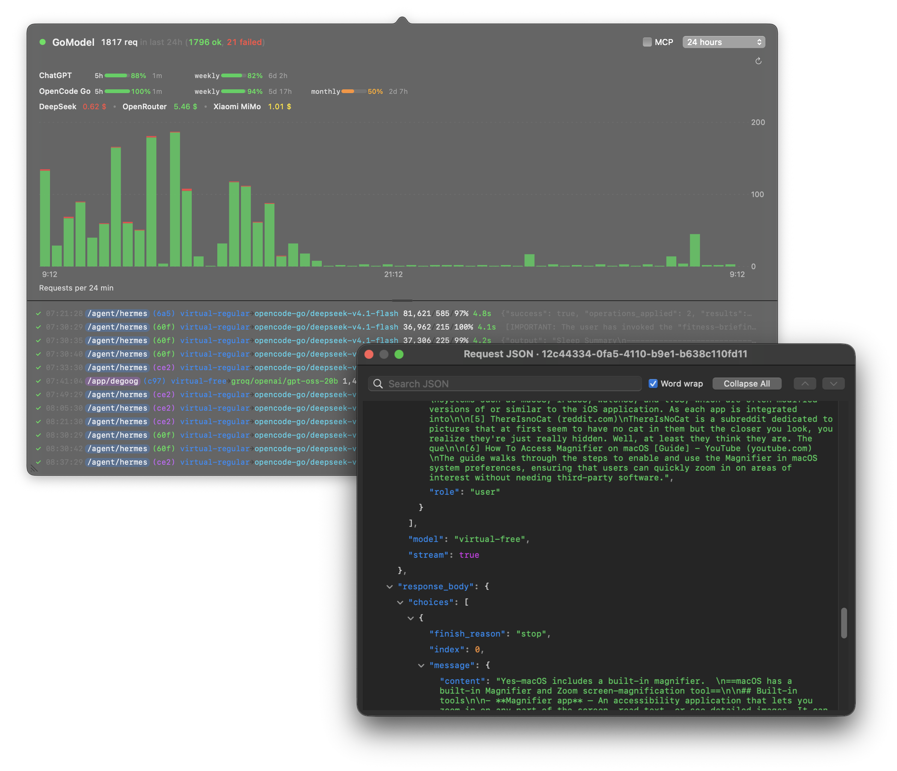
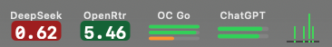

# GoModel menu bar app

A native, read-only macOS alternative to the TUI. Requires macOS 14 or newer
and Swift 6 / Xcode 16 or newer to build. The app uses AppKit, Swift Charts, Foundation,
and [Yams](https://github.com/jpsim/Yams) for the existing YAML configuration.
It runs in one process, without a database, daemon, or embedded web view.



## Build and launch

From the repository root:

```sh
make macos
make macos-dmg
open bin/GoModel.app
```

The build script produces an app with a GoModel chart icon, locally ad-hoc-signed
for the build machine's architecture. The DMG at
`dist/GoModel_<version>_macOS.dmg` opens as a drag-and-drop installer: drag
`GoModel.app` onto the `Applications` shortcut. The app is ad-hoc signed;
Developer ID signing and notarization are not part of this build, so macOS may
require opening it from Privacy & Security on first launch.

Use **Start at login** in the menu bar icon's right-click menu to register the
app as a macOS login item. macOS may require approval in System Settings.

For a preview with generated sample requests and no network connection:

```sh
open bin/GoModel.app --args --demo
```

For development without bundling:

```sh
swift run --package-path macos GoModelBar --demo
swift run --package-path macos GoModelBar --config /path/to/config.yaml --show
```

## Configuration

The app reads the same file as the TUI:
`~/.config/gomodeltui/config.yaml`, or `$XDG_CONFIG_HOME/gomodeltui/config.yaml`.
It uses `gomodel.url` and `gomodel.api_key`, along with optional OpenCode Go,
Command Code, ChatGPT / Codex, OpenRouter, DeepSeek, and Xiaomi MiMo credentials
under `providers`. It reads the Codex auth file when present; other provider
credentials come from YAML or environment variables.

Right-click the menu bar icon and choose **Configuration** to open the active
file in the default editor. The app does not create or rewrite configuration
files. File selection order:
`--config`, `GOMODELTUI_CONFIG`, previously selected file, then the default path.

`GOMODEL_URL` and `GOMODEL_API_KEY` override YAML values.
`OPENROUTER_API_KEY`, `DEEPSEEK_API_KEY`, and `MIMO_COOKIE` override the
corresponding provider values. `PROVIDERS_OPENCODE_API_KEY`,
`PROVIDERS_COMMANDCODE_COOKIE`, and `PROVIDERS_CODEX_AUTH_PATH` configure the
other providers. Codex defaults to `~/.codex/auth.json` when that file exists.
Finder launches normally do not inherit a terminal's environment, so use
the YAML file or launch the executable from that terminal when using these
variables. Config errors appear on the status circle's tooltip.

Use the **Usage icons** submenu in the right-click menu to choose which
configured providers get their own standard-width menu bar item. Quota items
show available-quota bars from shortest to longest window (for example, 5h,
weekly, monthly); balance items show the amount in a dark, color-coded pill.
Click any provider item to toggle the main dropdown. These choices are stored
in macOS preferences (`UserDefaults`), not in the YAML config, and start with no
additional provider icons selected.



The app keeps up to 24 hours of request history in memory. The live log shows
the last hour; older details are fetched when requested. Lightweight chart
activity is kept for the same 24-hour window. All request data stays in memory
and is discarded on quit.
Previews are bounded to 4,096 characters. When history omits bodies, missing
previews are fetched lazily for visible model-request rows, at most two at a
time. Only the bounded text is retained in the log; full bodies are discarded
after extraction. The JSON inspector keeps its full document until closed.

## Chart and request log

- The standard-width menu bar icon shows the last hour in 18 equal time columns.
  A two-pixel strip beneath the stacked activity bars turns
  red in any column containing a failed request, preserving even isolated errors.
- The dropdown uses a Swift Charts stacked bar chart with
  native axes. Successful requests are green; failures are red.
- Request counts sit beside the GoModel title: **123 req in last 1h
  (120 ok, 3 failed)**. Selecting chart buckets shows counts for that interval.
- Both charts use fixed clock-aligned buckets, including the current partial
  bucket. Existing requests stay in the same column until a bucket boundary
  advances the axis. Idle refreshes do not redraw the charts or animate bars.
- Clicking the image initially opens a panel half the width of that display.
  Drag either bottom-corner grip to resize it. The size is saved across reopening
  and relaunches, and limited to the current display's usable area. Minimum size
  is 640 × 390 points when the display permits it. A focused grip also accepts
  arrow keys (Shift for larger steps). Text retains its font size as the log grows.
  Drag the horizontal divider to change the chart/log split; its position is
  remembered across reopening and relaunches. Double-click it to reset. A focused
  divider accepts Up/Down (Shift for larger steps). Both sections retain a minimum
  height when resizing the dropdown.
  The chart's
  upper-right picker selects 5m, 15m, 1h, 3h, 6h, 12h, or 24h. Changing it
  filters the log to that duration and backfills missing history.
- Drag across the chart to select an interval, or click to select a single
  bucket. The interval is highlighted and the log shows only requests inside
  it, fetching their details if needed. Selection fixes the time axis while
  monitoring continues. **Live** clears the filter and restores the last hour.
- Each chart counts one completed logical request, using its final
  outcome. A failed attempt followed by a successful failover counts as one
  successful request. This differs from the TUI's attempt-based chart counts.
- The **MCP** checkbox immediately left of the time-window picker includes MCP
  items in the request log, dropdown chart, menu bar chart, and request totals.
  It starts unchecked. Completed MCP calls use the same green/red outcome
  stacks; unchecking removes them immediately. Traffic kind is retained with
  lightweight history so toggling also updates backfilled chart intervals.
  In-flight requests have a muted dot and are not counted.
- Hover over the large chart to see bucket times and counts. The label below
  it specifies the bucket duration. Empty buckets represent zero activity
  only once history has loaded; loading and incomplete-history states are
  shown explicitly.
- Configured provider quotas appear in compact provider rows above the chart,
  with adjacent remaining-quota bars, percentages, and reset countdowns. Hover
  a countdown for its absolute reset date. OpenRouter, DeepSeek, and MiMo
  balances appear together in a compact line; provider names open the provider
  page. A refresh control updates provider usage, and failures remain visible
  there with an error indicator.
- The right-click **Usage icons** submenu independently toggles menu bar items
  for configured providers. Quotas use bars ordered by window duration, shortest
  first. Balances use dark, color-coded pills. Selection is saved in local macOS
  preferences; clicking a provider item toggles the main dropdown.
- The request log uses compact colored monospaced text lines with timestamp, a
  background-tinted rounded app-path pill, a color-coded `(xyz)` session suffix,
  source/destination models, usage in
  `input/output/cache` form, latency, and a truncated conversation preview or error.
  Token counts use comma thousands separators, such as **123,123**. In-flight
  rows use lighter text and show elapsed latency ticking once per second; it
  pulse gently and show elapsed latency ticking every 0.1 seconds; latency
  freezes to the final reported duration when the response arrives. The dropdown
  stays open while the JSON inspector is in use. The log fits
  the dropdown width and scrolls
  vertically; row tails are truncated when necessary. Rows have
  no hover tooltips. A subtle background highlight and pointing-hand cursor
  identify the hovered row. The highlight follows the pointer as rows scroll
  or update. Clicking a row opens the full JSON inspector.
  Missing values use an em dash; known zeros remain zero.
  Timestamps use a fixed-width slot with right padding, keeping app paths aligned
  across outcomes and times. Font size, character spacing, and row height stay
  fixed during live updates and backfill; overflowing text is tail-truncated.
  Visible rows recover missing conversation previews from the detail endpoint;
  existing previews survive later compact history updates.
- Late `usage.*` events enrich input/output tokens and cache values, including
  after a request has completed. They never change its outcome or count it again.
- Click a request line to open a native, resizable JSON inspector. It fetches
  the complete persisted audit entry, including request/response bodies, from
  `GET /admin/audit/detail`. Keys, strings, numbers, booleans, and null values
  have syntax colors. The root is open; all nested objects and arrays start
  collapsed. Single-click anywhere on a container row to expand or collapse it.
  **Expand All** opens every object and array, then becomes **Collapse All** to
  close nested branches while keeping the root open. Manually collapsed
  branches stay closed until reopened or visited through search navigation.
  Expanding or collapsing keeps the clicked item at its current scroll position.
  The popup provides horizontal scrolling when word wrapping is off. Enable the
  **Word wrap** checkbox beside search to fit lines to the popup width.
  Continuation lines keep the JSON item's nesting indentation. Wrapping starts
  off, and the choice is kept while switching requests in the running app.
- Type in the inspector's search box to highlight and scroll to the first
  case-insensitive match, including matches inside collapsed branches. Only
  the matching ancestors are opened. Previous/next buttons move between
  occurrences and wrap around; Return and Shift-Return also navigate.
  The result counter shows the current match and total. Closing the popup
  releases its full request data.
  With wrapping enabled, search scrolls to the matching line within long values.
- Paths, models, and providers have stable colors. Outcomes are green/red;
  successful failovers are amber. Latency is green below 5 seconds, amber
  from 5 through 30 seconds, and red above 30 seconds.
- Newest rows appear at the bottom. Scrolling upward pauses following and
  preserves the reading position. Near the top, another hour is loaded lazily,
  up to the 24-hour history limit. Keep scrolling upward to pass empty intervals.
  Scrolling back to the bottom releases older details and resumes the chosen
  rolling duration (one hour by default).
  A chart selection stays confined to its interval. One bottom-center arrow
  labeled **Live** appears while scrolled up or viewing another time window;
  clicking it returns to the live hour
  and releases older request details. Request text uses a fixed width font
  with ligatures disabled.
- Click outside, press Escape, or click the menu bar chart again to close the
  panel. Collection continues while closed. Right-click the menu bar icon for
  **Usage icons**, **Reconnect**, **Configuration**, and **Quit GoModel**. The
  panel has no footer toolbar.
- A green/red circle beside the title shows connection state. Hover it for details.
- Selecting already loaded chart intervals reuses their history. Connected
  stream coverage is accounted for before planning backfill, avoiding scans
  for tiny timer gaps. Loading status clears when the displayed interval is covered,
  even if background history work continues.
- History pagination stops at the requested interval's oldest timestamp instead
  of scanning earlier rows from the same day. Only intersecting UTC days are
  fetched. Stalled pages and loads exceeding two minutes report incomplete
  history with a reconnect prompt; cancelled loads clear their status.

## Connection lifecycle

The app reads `GET /admin/live/logs`, `GET /admin/audit/log`, and, when inspecting
a request, `GET /admin/audit/detail`. It starts
with one hour of history, loads longer windows on demand, and merges stream
and paginated history records by request ID. It resumes SSE using
`Last-Event-ID`, backs off reconnects, and backfills after reconnecting or
waking from sleep. A faded chart with a gray dot indicates disconnection.
Requests never follow HTTP redirects with the admin credential. No requests
write to GoModel or change provider accounts.

## Checks

```sh
make macos-test
make macos
make macos-dmg
```

Core tests cover SSE framing, replay/history overlap, final outcomes, failovers,
MCP separation, chart selection boundaries, history coverage and lazy loading,
scroll anchor preservation, previews, configuration parsing, and redacted
configuration errors. Native view tests check panel sizing and render light/dark
previews into `/private/tmp/gomodelbar-preview` (override with
`GOMODELBAR_RENDER_DIR`). The `macos` CI job runs the Swift tests and app build;
the existing Go checks continue independently.

For manual UI checks, launch `--demo`: inspect the chart at 1h, change all
windows, scroll up and resume following, click text lines, and check
light/dark appearance, a smaller display, Retina scaling, and a second monitor.
The README images show the current TUI and native macOS layouts.
